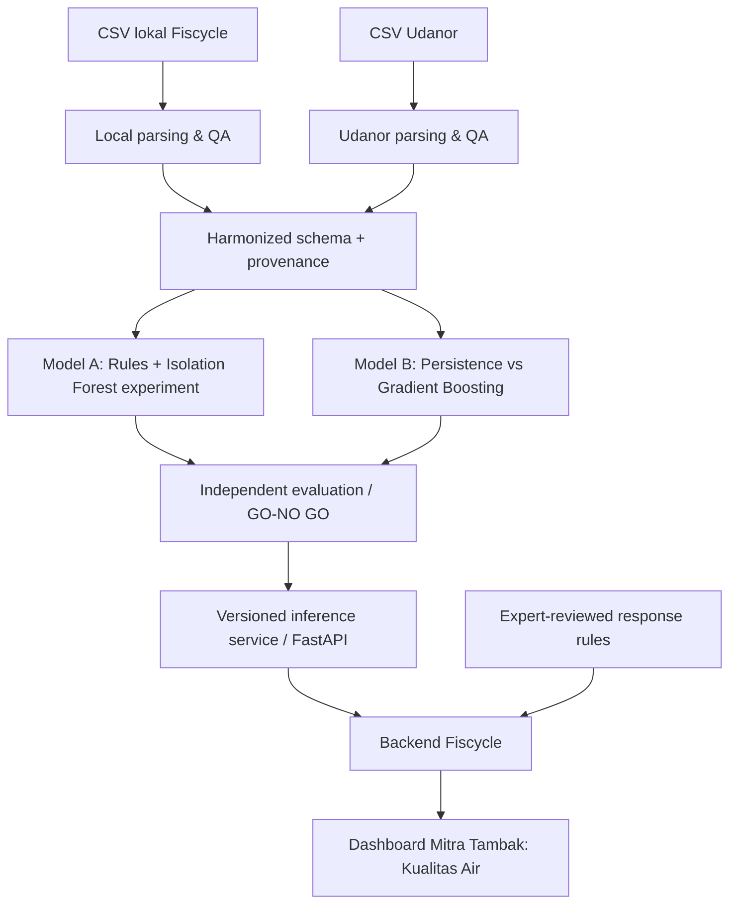

# FISCYCLE — WATER QUALITY AI MVP IMPLEMENTATION PLAN

**Versi:** 1.0 — Rencana implementasi, belum laporan hasil eksperimen  
**Tanggal:** 2 November 2026  
**Produk:** Fiscycle — Integrated AI-Driven Circular Aquaculture Ecosystem  
**AI Engineer:** Rasya  
**Product Owner / Koordinasi AI & Implementasi:** Nanda  
**Dokumen sumber internal:** `Fiscycle_PRD_v1.0.docx`, `Fiscycle_Data_AI_Readiness_Research_2026.xlsx`, `Log Lele - kolam_01.csv`  
**Status:** Dataset lokal tersedia dan telah diperiksa secara awal; file mentah Udanor belum diaudit di workspace; belum ada model Fiscycle yang diklaim telah dilatih atau lolos evaluasi.

---

## 1. Jawaban utama: targetnya apa?

### 1.1 North-star outcome

**Membantu operator tambak menggunakan pembacaan pH, suhu, dan kekeruhan yang dapat dipercaya serta memperoleh indikasi perubahan parameter 30 menit lebih awal, sehingga operator tahu kapan harus memeriksa sensor atau meninjau kondisi kolam.**

Ini adalah **target kemampuan produk**, bukan klaim bahwa dampak biologis atau penghematan sudah terbukti. Target MVP **BUKAN**: memastikan ikan sehat; memprediksi mortalitas; memastikan seluruh kualitas air aman; memprediksi DO/TAN/amonia tanpa pengukuran; atau mengaktifkan aerator secara otomatis.

### 1.2 Dua kapabilitas AI yang dibuat

| Kode | Kapabilitas | Pertanyaan pengguna | Keluaran utama | Model/metode pertama | Prioritas |
|---|---|---|---|---|---|
| **A** | **Water Sensor Anomaly Detection** | “Apakah data sensor yang saya lihat dapat dipercaya?” | `VALID`, `SENSOR_ERROR`, `SUSPICIOUS`, `INSUFFICIENT_DATA`; alasan dan rekomendasi pemeriksaan | **Rule-based QA wajib**, **Isolation Forest** sebagai komponen ML eksperimental | P0 untuk QA; P1 untuk ML |
| **B** | **30-Minute Water Quality Forecasting** | “Bagaimana kemungkinan pH, suhu, dan kekeruhan 30 menit mendatang?” | Prediksi numerik pada `t+30 menit`, per parameter, dengan keterbatasan/coverage | **Persistence baseline** → **HistGradientBoostingRegressor** (tiga estimator per parameter) | P1, hanya jika mengungguli baseline |

> Dua *kapabilitas* AI bukan berarti hanya ada dua berkas model. Pada Model B, satu pipeline dapat memuat tiga estimator terpisah untuk pH, temperatur, dan turbidity. Karena fitur yang dipakai harus tersedia saat inference, jangan melatih model yang membutuhkan DO atau TAN sebagai input wajib untuk tambak lokal saat ini.

### 1.3 Kriteria sukses MVP (usulan yang harus disahkan tim)

**P0 — Wajib berfungsi, bahkan bila ML tidak lolos:**
1. Semua data masuk membawa `source`, `pond_id`, `timestamp`, parameter, unit, dan status kualitas data.
2. **100% skenario uji yang jelas tidak valid** (misalnya `-127°C`, pH di luar batas matematis 0–14, timestamp hilang) harus diblokir oleh *rule engine* agar tidak ikut diagnosis air atau training target.
3. Data dengan `DO` dan `TAN` tidak tersedia ditampilkan sebagai **tidak tersedia**, bukan nol atau hasil estimasi yang tampak seperti pengukuran.
4. Dashboard dapat menampilkan data lokal historis, status sensor, alasan peringatan, sumber data, dan tindakan pemeriksaan.
5. Tidak ada label **“air aman sepenuhnya”**, diagnosis amonia numerik, atau tindakan otomatis tanpa bukti dan persetujuan ahli.

**Model A — GO jika:**
- Rasya menghasilkan katalog anomali dan *review set* dengan penilaian manual/operator; metrik *precision*, *recall* untuk kelas yang dapat diverifikasi, dan alarm palsu per kolam per hari dilaporkan.
- Isolation Forest menemukan **nilai tambah di atas QA rules** pada data uji lokal: anomali tambahan yang dikonfirmasi, dengan jumlah alarm yang masih dapat ditangani operator. Tidak boleh menganggap skor anomali sebagai bukti bahaya bagi ikan.
- Jika tidak ada bukti peningkatan, **tetap gunakan rules sebagai fitur produksi; status Isolation Forest = research-only.**

**Model B — GO jika:**
- Evaluasi menggunakan **holdout lokal terbaru yang belum pernah dipakai untuk fitting maupun tuning**, serta pembandingan terhadap `last observed value` (*persistence*) dan, bila relevan, rolling average.
- **Target eksperimen awal yang diusulkan**: penurunan MAE **≥10% terhadap persistence pada suatu parameter** pada horizon 30 menit, konsisten dalam pengujian berurutan. Ini **ambang keputusan usulan, bukan hasil yang sudah dicapai**. Parameter lain yang tidak lolos tetap ditampilkan sebagai tren historis, bukan prediksi AI yang tervalidasi.
- Metrik per parameter: MAE (pH, °C, satuan turbidity), RMSE, bias, jumlah prediksi yang dapat dibuat (*coverage*), dan kualitas prediksi pada periode perubahan cepat.
- Jika model tidak mengungguli baseline, **jangan memaksakan deployment ML**; tampilkan baseline/tren sebagai fitur analitik berlabel tepat.

**Target demo end-to-end:** satu alur di dashboard `kolam_01`: pengguna melihat pembacaan bermasalah → sistem menandai sensor error dan menahan interpretasi → pengguna membuka pembacaan valid berikutnya → jika model B lolos, sistem menampilkan forecast 30 menit beserta sumber, timestamp, dan keterbatasannya → operator bisa mencatat tindak lanjut. Demo menggunakan data historis nyata harus diberi label **REAL RECORDED**, bukan **LIVE**.

---

## 2. Dataset terpilih dan perannya

### 2.1 Dataset lokal — Fiscycle Ponorogo (utama)

**Berkas:** `Log Lele - kolam_01.csv`  
**Kolom asli:** `Waktu`, `pH`, `Suhu`, `Turbidity`, `Sisa Pakan`.

**Hasil audit awal langsung dari CSV:**
- **23.905 baris**, rentang `2026-08-22 18:08:49` sampai `2026-10-28 16:24:46`.
- 55 tanggal memiliki pembacaan; rentang kalender mencakup sekitar 68 hari. **Jangan menganggap 68 hari adalah observasi kontinu.**
- Median jarak antarrekaman **180 detik**; terdapat beberapa *gap* besar, termasuk gap terpanjang sekitar **10 hari 9 jam 44 menit**.
- **414 pembacaan suhu `-127`**; ini harus diperlakukan sebagai indikasi error sensor.
- Format desimal bercampur (`7,04`, `28.19`) dan sedikit string angka ambigu (`46,119.00`, `46,363.00`, `46,384.00`); **jangan menebak perbaikannya**.
- `Turbidity` mencakup nilai 0–100 dalam parsing awal; satuan dan apakah 100 adalah *clipping* **belum dikonfirmasi**.
- `Sisa Pakan` memiliki nilai kosong dan nilai terisi semuanya `0`; **jangan gunakan sebagai fitur feeding intelligence**.
- Tidak ada pengukuran DO dan TAN pada file ini.

**Peran:**
- Training dan *time-based holdout* untuk Model A/B;
- contoh kasus error sensor yang benar-benar terjadi;
- evaluasi paling relevan untuk keputusan pada kolam Fiscycle.

**Catatan validasi:** keberadaan banyak baris bukan bukti banyak kolam atau banyak kejadian biologis independen. Satu kolam membatasi klaim generalisasi.

### 2.2 Dataset eksternal — Udanor (pendukung dan eksperimen)

**Nama:** *Sensor-Based Aquaponics Fish Pond Datasets*  
**Sumber:** University of Nigeria Nsukka / C. N. Udanor dkk., *Data in Brief* 2022.  
**Paper:** https://doi.org/10.1016/j.dib.2022.108400  
**Kaggle:** https://www.kaggle.com/datasets/ogbuokiriblessing/sensor-based-aquaponics-fish-pond-datasets

**Metadata publikasi:** sekitar 12 file kolam aquaponics lele; parameter meliputi `created_at`, `Temperature(C)`, `Turbidity(NTU)`, `Dissolved Oxygen(mg/l)`, `pH`, dan parameter lain; pencatatan nominal sekitar 5 detik. **Jumlah file yang benar-benar dapat diunduh, kualitas per kolam, timestamp aktual, dan lisensi pada versi Kaggle harus diperiksa Rasya.** Paper lanjutan menyebut rilis dataset dengan CC BY 4.0; tetap catat lisensi sumber unduhan dan atribusinya.

**Peran:**
- **Model A:** pengujian anomali dan perbedaan pola antar-kolam (mulai terpisah, bukan asal gabung).
- **Model B:** bandingkan `LOCAL_ONLY` versus `LOCAL+UDANOR`, dan `UDANOR_PRETRAIN → LOCAL_ADAPT` apabila metode memungkinkan.
- DO Udanor **tidak membuat Fiscycle punya DO lokal**. Jangan mengisi DO lokal dengan nol atau hasil prediksi dari Udanor seolah pengukuran.

**Peringatan penting:** aquaponics Nigeria berbeda dari lingkungan Ponorogo; satuan *turbidity* lokal belum terverifikasi; kolom sensor gas amonia pada Udanor bukan pengganti pengukuran TAN terlarut lokal. **Training gabungan baru boleh dilakukan setelah audit kesetaraan satuan, sensor, cadence, dan distribusi.**

### 2.3 Kebijakan penggabungan dataset

**TIDAK langsung `concat(raw_local, raw_udanor)` lalu training.** Jalur yang disetujui untuk eksperimen:

1. Simpan data mentah **terpisah dan immutable**.
2. Bersihkan, standardisasi, dan dokumentasikan aturan **per sumber**.
3. Simpan `source_dataset`, `source_pond_id`, satuan, waktu, dan `quality_flag` di setiap record.
4. Bentuk fitur *lag/window* **di dalam setiap pond_id secara terpisah**; jangan ada jendela yang melintasi dua kolam, dua sumber, atau gap data.
5. Jika satuan turbidity lokal belum cocok, **Model B lintas sumber hanya memakai pH dan suhu**. Turbidity diprediksi dari model lokal saja.
6. Buat *combined harmonized table* untuk eksperimen; bukan satu time-series raksasa.
7. **Uji semua kandidat pada test set lokal yang sama**, bebas dari tuning dan preprocessing yang mempelajari statistik test set.

---

## 3. Arsitektur teknis yang diusulkan



**Dua layer runtime yang jangan dicampur:**
- **Data quality & ML inference:** memeriksa kelayakan pembacaan dan memprediksi nilai parameter.
- **Domain decision support:** mengubah input tervalidasi menjadi catatan pemeriksaan/tindakan hanya berdasarkan aturan yang telah disetujui ahli. **Anomali sensor bukan otomatis kondisi air berbahaya.**

---

## 4. Flow kerja Rasya — dari raw CSV sampai AI API

### Fase 0 — Konfirmasi masalah dan definisi hasil (P0)

**Kegiatan:**
- Setujui dua fungsi: Model A (sensor QA/anomali) dan Model B (forecast `t+30 menit`).
- Konfirmasi bahwa `kolam_01` adalah basis evaluasi lokal; periksa jenis ikan, sensor, satuan, timezone, catatan kalibrasi, pergantian sensor, dan intervensi kolam.
- Setujui kondisi UI: `VALID`, `SENSOR_ERROR`, `SUSPICIOUS`, `STALE`, `INSUFFICIENT_DATA`.
- Tetapkan daftar contoh uji yang diketahui: `-127°C`, pH mustahil, missing readings, gap, timestamp duplikat, flatline, perubahan ekstrem, dan turbidity batas 0/100 yang perlu investigasi.

**Deliverable:** `problem_definition.md`, `schema_contract.md`, daftar unknowns dan keputusan produk.  
**Owner:** Nanda (WHAT/WHY dan acceptance), Rasya (feasibility), IoT Lead (perangkat), ahli budidaya (batas penilaian air).

### Fase 1 — Data acquisition dan audit provenance (P0)

**Rasya:**
- Simpan CSV lokal asli, catat hash SHA-256 dan versi file.
- Unduh Udanor dari Kaggle; inventarisasi setiap pond file dan hash-nya.
- Catat lisensi, sumber, DOI, jumlah baris, nama kolom, rentang waktu, satuan dan rekaman aneh per kolam.
- Pisahkan `data/raw/local/` dan `data/raw/udanor/`; jangan mengedit raw file.

**Deliverable:** `data_inventory.csv`, `data_dictionary.md`, `source_licenses.md`, `eda_local.ipynb`, `eda_udanor.ipynb`.

**STOP jika:** lisensi tidak mengizinkan penggunaan yang dimaksud, data Udanor tidak bisa diperiksa, atau satuan utama tidak dapat dipahami. Lokal tetap bisa digunakan.

### Fase 2 — Cleaning terpisah dan harmonization (P0)

**Schema target:**

| Kolom | Tipe / arti |
|---|---|
| `timestamp` | Datetime yang timezone-nya terdokumentasi; jangan mengarang offset |
| `source_dataset` | `fiscycle_local` / `udanor_public` |
| `pond_id` | ID unik **per sumber** (`fiscycle:kolam_01`, `udanor:pond_01`) |
| `ph` | Float, validasi batas matematis dan QA terpisah |
| `temperature_c` | Float, °C |
| `turbidity_value`, `turbidity_unit` | Nilai + unit sensor asli; hanya dinormalisasi jika valid |
| `do_mg_l` | Nullable; hanya diisi jika benar-benar diukur pada sumber itu |
| `qa_reason`, `qa_status` | Alasan invalid/curiga/valid dari rules |
| `raw_record_id` | Kunci rekaman asli untuk audit |

**Aturan yang wajib dibuat:**
- Parser koma/titik desimal yang aman; simpan nilai raw bila ambigu. String seperti `46,119.00` **ditandai untuk review**, tidak diubah diam-diam menjadi pH 7 atau angka lain.
- Nilai temperatur `-127` menjadi `SENSOR_ERROR` dan `clean_temperature_c = null`; raw tetap tersedia untuk audit.
- Missing/gap/flatline/clipping dicatat berbeda dari pengukuran air berisiko.
- Timestamps diurutkan per kolam dan diuji duplikasi; *resample* hanya pada segmen kontinu.
- Tentatif grid bersama **3 menit**: resampling Udanor dari frekuensi tinggi menggunakan agregasi robust dan persyaratan *coverage*; cek cadence aktual terlebih dahulu. Hindari interpolasi lintas gap besar.
- Simpan *quality report* jumlah baris raw, valid, invalid, ambiguous, missing, dan panjang gap.

**Deliverable:** `local_clean.parquet`, `udanor_clean.parquet`, `combined_harmonized.parquet` (hanya setelah kompatibilitas diverifikasi), `qa_report.md`.

### Fase 3 — Split dan baseline tanpa data leakage (P0)

- Tetapkan **final holdout lokal berupa blok waktu paling baru yang layak** sebelum tuning. Contoh awal: 70% train, 15% validation, 15% test **secara kronologis pada segmen valid**; persentase disesuaikan bila gap membuat sebagian segmen tidak layak.
- Pasang *purge/gap* di sekitar perbatasan split untuk *lag windows* dan horizon target 30 menit; gunakan *rolling-origin evaluation* di training/validation.
- Semua transformasi yang mempelajari statistik (scaler, imputer, threshold learned from data) **fit pada training saja**.
- Baseline Model A: rule-only; Model B: `y(t+30) = y(t)` dan rolling mean (jika menguntungkan).

**Deliverable:** versi split, baseline metrics, data leakage checklist.

### Fase 4 — Model A: Water Sensor Anomaly Detection (P0 + P1)

**Baseline wajib — tanpa training:**
1. Rules untuk invalid range, sentinel, timestamp, missing, stale, flatline, dan clipping yang *dikonfirmasi*.
2. Jangan menggabungkan `sensor_fault` dengan `unusual_water_reading` ke label yang sama.
3. Model tidak boleh menghasilkan saran biologis dari nilai invalid.

**Eksperimen ML:**
- Pilihan pertama: `sklearn.ensemble.IsolationForest` pada *normal/clean windows*, dengan fitur `ph`, `temperature_c`, turbidity jika unit sudah jelas, rolling median/std, *first difference*, durasi flatline, dan time-gap indicator.
- Latih **local-only** dahulu. Udanor dipakai sebagai eksperimen lintas sumber; fitur yang tidak kompatibel dikeluarkan.
- Buat dataset evaluasi dari: contoh raw error yang diketahui + *manual review* sampel anomali tambahan + sampel normal (sampling terstruktur). *Synthetic corruption* boleh digunakan **untuk uji robustness**, tetapi dipisahkan dari kasus nyata.
- Tuning `contamination`/threshold **pada validation set**, bukan test set.

**Output API:** status QA rules, *anomaly score*, *reason codes*, dan `needs_review`. Jangan menyebut *anomaly score* sebagai probabilitas kematian ikan atau kepastian kerusakan sensor.

**Kondisi NO-GO ML:** tidak ada ground truth yang memungkinkan evaluasi, terlalu banyak alarm palsu, atau seluruh temuan ML sudah tertangkap oleh rules.

### Fase 5 — Model B: 30-Minute Water Quality Forecasting (P1)

**Target variabel:** `ph(t+30 menit)`, `temperature_c(t+30 menit)`, `turbidity(t+30 menit)` jika unit dan kualitas memungkinkan.

**Fitur kandidat (hanya informasi yang tersedia saat prediksi):**
- Lag 3, 6, 15, 30, 60 menit; histori rolling 15, 30, 60 menit;
- nilai terakhir, perubahan nilai, median/rata-rata/deviasi standar pada window valid;
- waktu dalam sehari **setelah timezone diverifikasi**;
- identitas sumber/kolam hanya untuk eksperimen lintas sumber yang sesuai.

**Algoritma:**
1. `Persistence` / rolling mean: baseline yang wajib dikalahkan.
2. `HistGradientBoostingRegressor` dari scikit-learn: pilihan pertama supervised tabular time-series dengan lag features.
3. `RandomForestRegressor` hanya sebagai pembanding sederhana jika diperlukan.
4. Tidak perlu LSTM/Transformer di MVP kecuali baseline sederhana terbukti tidak cukup dan evaluasi mendukung kompleksitasnya.

**Rancangan eksperimen:**
- `B0_LOCAL_BASELINE`: persistence, rolling mean.
- `B1_LOCAL_ML`: tiga regressor dari data lokal.
- `B2_COMBINED_ML`: data lokal + Udanor **hanya untuk kolom/unit yang betul-betul kompatibel**; seluruh window per kolam terpisah.
- `B3_TRANSFER_EXPERIMENT` (opsional): pretraining/augmentasi dari Udanor dan adaptasi lokal jika pendekatan model benar-benar mendukung.
- Evaluasi semua kandidat pada **test set lokal yang sama dan belum disentuh**.
- Jika turbidity lokal bukan NTU atau prosedurnya berbeda, **turbidity lokal tidak dicampur dengan NTU Udanor**; boleh tetap ada model forecast turbidity local-only.

**Metrik:** MAE/RMSE per parameter, bias, coverage prediksi, improvement terhadap baseline; laporkan jumlah test windows, waktu test, dan performa pada perubahan tajam. Jika memungkinkan, laporkan rentang ketidakpastian **hanya setelah kalibrasi**, bukan confidence palsu.

**GO/NO-GO:** hanya deploy ML untuk parameter/horizon yang mengungguli baseline secara konsisten dan memiliki kualitas data cukup.

### Fase 6 — Integrasi aplikasi (P0 untuk QA; P1 untuk forecast)

**Arsitektur yang disarankan:** service Python **FastAPI** yang memuat artefak model berversi; aplikasi/backend Fiscycle memanggilnya via REST. Rasya menyiapkan `inference pipeline + API contract`, Tech Lead/Backend menyiapkan auth, penyimpanan event, dan integrasi UI.

**Contoh request** (skema ilustratif, bukan endpoint produksi final):

```http
POST /api/v1/water/analyze
Content-Type: application/json
```

```json
{
  "pond_id": "fiscycle:kolam_01",
  "source_type": "REAL_RECORDED",
  "readings": [
    {"timestamp":"2026-10-28T16:21:46+07:00","ph":7.03,"temperature_c":30.10,"turbidity_value":41.0,"turbidity_unit":"UNCONFIRMED"}
  ]
}
```

**Catatan:** timestamp dan timezone dalam contoh API di atas mengilustrasikan format yang diinginkan; zona waktu data mentah **belum terverifikasi**. Label `REAL_RECORDED` tidak boleh diubah menjadi `LIVE` tanpa koneksi perangkat yang benar-benar aktif.

```json
{
  "pond_id": "fiscycle:kolam_01",
  "data_quality": {"status":"VALID", "reasons":[], "version":"qa-rules-v1"},
  "forecast": {
    "status":"NOT_AVAILABLE_UNTIL_VALIDATED",
    "horizon_minutes":30,
    "predictions":null,
    "model_version":null
  },
  "water_risk": "INSUFFICIENT_DATA_FOR_FULL_ASSESSMENT",
  "missing_parameters": ["DO", "TAN"],
  "source_type":"REAL_RECORDED"
}
```

**Saat model B lolos gate**, `predictions` dapat berisi `ph`, `temperature_c`, dan `turbidity_value` dengan waktu target serta metadata model, tanpa mengganti data terukur. Jika sensor input invalid/terlalu stale, kembalikan `INSUFFICIENT_DATA`, bukan angka prediksi yang seolah andal.

**Yang harus ada di UI:** status sumber, waktu pengukuran terakhir, indikator QA, prediksi yang jelas berbeda dari data aktual, alasan, tombol `Periksa Sensor` / `Lihat Riwayat`, dan kondisi *unavailable*.

### Fase 7 — UAT, demo, dan handover (P0)

**Skenario demo minimal:**
1. Buka data historis `kolam_01` → label **real recorded**.
2. Pilih pembacaan `-127°C` → `SENSOR_ERROR`, bukan status air dingin.
3. Pilih kasus angka ambigu → `NEEDS_REVIEW`; data raw tetap tersimpan.
4. Pilih periode sensor valid → tampilkan tren parameter.
5. Jika Model B GO → tampilkan forecast `+30 min` dan bandingkan dengan realisasi historis pada bagian test yang tidak digunakan training.
6. Matikan inference service / kirim data tidak lengkap → aplikasi tetap berfungsi dengan status tidak tersedia dan aturan QA.

**Handover Rasya:** model file dan versi, source code, dependencies lockfile, preprocessing pipeline, training command, evaluation report, sample API requests/responses, dan known limitations.

---

## 5. Pembagian tugas dan keputusan

| Pekerjaan | PIC utama | Kolaborator | Bukti selesai |
|---|---|---|---|
| Problem, scope, UX, acceptance | **Nanda** | Rasya, Tech Lead | Approved targets dan flow UI |
| Download/QA dataset, cleaning, harmonization | **Rasya (AI Engineer)** | IoT Lead | Data dictionary, EDA, quality report |
| Feature engineering, baselines, model A/B, evaluasi | **Rasya** | Ahli budidaya | Notebook/scripts, metrik validasi, model card |
| Sensor specs, unit, firmware, kalibrasi, data ingest | **IoT/Hardware Lead** | Rasya | Sensor specification dan data source contract |
| Aturan kondisi air dan tindakan aman | **Ahli budidaya / dosen** | Nanda, Rasya | Rule review dan batas penggunaannya |
| API backend/auth/event storage/monitoring | **Technical Lead / Backend** | Rasya | API integration tests dan audit trail |
| Status dan penjelasan di aplikasi | **Nanda (UI/UX)** | Backend, Rasya | UAT flow dan empty/error states |
| Keputusan GO/NO-GO dan klaim pitch | **Nanda** | Rasya, Technical Lead, ahli | Acceptance sign-off dan limitation statement |

---

## 6. Struktur repositori yang disarankan

```text
fiscycle-water-ai/
├── README.md
├── docs/
│   ├── problem_definition.md
│   ├── data_dictionary.md
│   ├── model_cards/
│   └── evaluation_report.md
├── data/
│   ├── raw/local/                 # tidak diubah; akses sesuai izin
│   ├── raw/udanor/                # atribusi, lisensi, source hash
│   ├── interim/                   # parsed + QA flags
│   └── processed/                 # versioned, leakage-safe splits
├── notebooks/
│   ├── 01_eda_local.ipynb
│   ├── 02_eda_udanor.ipynb
│   └── 03_experiments.ipynb
├── src/
│   ├── ingest.py
│   ├── quality_rules.py
│   ├── harmonize.py
│   ├── make_features.py
│   ├── train_anomaly.py
│   ├── train_forecast.py
│   ├── evaluate.py
│   └── inference.py
├── models/                        # artefak terversi, jangan commit besar
├── api/main.py
├── tests/
│   ├── test_quality_rules.py
│   ├── test_no_leakage.py
│   ├── test_inference.py
│   └── test_api.py
└── requirements.txt
```

**Minimal dependency:** Python, pandas, NumPy, scikit-learn, joblib, FastAPI, pytest, dan library plotting untuk EDA. Model gradient boosting dapat dibuat dengan scikit-learn tanpa GPU. Gunakan Git untuk kode, bukan untuk mempublikasikan data lokal mentah tanpa izin.

---

## 7. Checklist eksekusi berurutan untuk Rasya

### Gate 1 — Dataset siap dianalisis
- [ ] Raw data lokal dipreservasi, hash dicatat.
- [ ] Dataset Udanor asli berhasil diunduh, file per kolam diperiksa.
- [ ] Lisensi dan atribusi Udanor diverifikasi pada versi unduhan.
- [ ] Satuan turbidity lokal, timezone, dan sensor hardware dikonfirmasi atau ditandai unknown.
- [ ] EDA dan QA report lengkap untuk kedua sumber.

### Gate 2 — Dataset siap dipakai model
- [ ] Schema konsisten dan setiap baris memiliki provenance.
- [ ] Error `-127°C` dan angka ambigu masuk QA flag.
- [ ] Resampling tidak menutupi gap panjang.
- [ ] Split kronologis dan batas per-pond diterapkan.
- [ ] Test set lokal dikunci dan tidak dipakai tuning.

### Gate 3 — Model A
- [ ] Unit tests semua aturan QA lulus.
- [ ] Isolation Forest local-only ditraining sebagai eksperimen.
- [ ] Review anomali dan false-alarm report tersedia.
- [ ] Ditetapkan keputusan: `RULES_ONLY` atau `RULES_PLUS_ML`.

### Gate 4 — Model B
- [ ] Persistence baseline dan rolling mean sudah dihitung.
- [ ] Model regresi local-only dilatih dan dinilai pada validation.
- [ ] Model gabungan Udanor dilatih **hanya jika kompatibel**.
- [ ] Semua kandidat diuji pada final local holdout sama.
- [ ] Ada keputusan GO/NO-GO per parameter, bukan klaim akurasi umum.

### Gate 5 — Aplikasi dan demo
- [ ] Inference service berjalan dengan model versioning.
- [ ] Backend punya kontrak API, autentikasi, dan log.
- [ ] Dashboard membedakan data aktual, historical, forecast, dan unavailable.
- [ ] Tidak ada DO/TAN atau status air aman yang diada-adakan.
- [ ] Demo reproduksibel, dengan fallback jika model gagal.

---

## 8. Risiko yang harus diantisipasi

| Risiko | Dampak | Mitigasi |
|---|---|---|
| Hanya satu kolam lokal | Generalisasi terbatas | Holdout temporal jujur, kumpulkan kolam tambahan nanti |
| Data 3 menit tetapi ada gap panjang | Forecast palsu bila dipaksa kontinu | Segmentasi timeline; no windows across gaps |
| `-127°C` dan nilai format rusak | Model belajar error sebagai kondisi air | Rules sebelum training/inference; raw tetap dicatat |
| Turbidity tidak sama satuannya | Combined training tidak valid | Verifikasi sensor; fallback pH+suhu cross-source |
| Domain shift lokal vs aquaponics Nigeria | Performa model gabungan buruk | Jadikan local test penentu, bukan skor publik |
| Tidak ada label kerusakan sensor independen | Sulit membuktikan precision ML | Operator review dan eksperimen terpisah |
| Nilai parameter berubah lambat | Persistence mengalahkan ML | Ukur improvement; jangan deploy ML bila tidak unggul |
| Tidak ada DO/TAN lokal | Tidak bisa mengklaim status air lengkap | Tampilkan parameter unavailable; tidak mengarang hasil |
| Demo historical diklaim real-time | Kesalahan provenance/pitch | Badge `REAL_RECORDED`; source timestamp |
| Model gagal/endpoint tidak tersedia | UI menampilkan hasil stale | Timeouts, status unavailable, fallback rule QA |

---

## 9. Bagaimana menyampaikan AI kepada juri

**Pernyataan yang valid setelah benar-benar diimplementasikan:**

> “Fiscycle mengembangkan dua komponen Water Intelligence. Pertama, quality-control dan deteksi anomali pembacaan sensor. Kedua, prototipe prediksi pH, suhu, dan kekeruhan 30 menit ke depan. Kami menggunakan data sensor historis kolam lokal untuk evaluasi utama dan dataset aquaponics Udanor dari publikasi ilmiah sebagai sumber eksperimen tambahan. Semua hasil diuji terhadap baseline sederhana pada data lokal yang dipisahkan berdasarkan waktu. Fitur prediksi hanya kami tampilkan sebagai AI yang telah dievaluasi jika memang melampaui baseline. Status DO dan amonia tetap dinyatakan tidak tersedia karena tidak ada pengukuran lokal.”

**Jangan katakan:** “AI sudah terbukti mencegah kematian ikan”, “akurasi 95%” tanpa metrik dan laporan, “semua kolam tervalidasi”, atau “dataset publik adalah data tambak kami.”

---

## 10. Keputusan teknis final untuk mulai bekerja

1. **Dataset:** hanya Fiscycle `kolam_01` dan Udanor, sesuai keputusan tim. Keduanya diproses terpisah terlebih dahulu.
2. **Model A:** QA rules diprioritaskan sebagai produk; Isolation Forest **dievaluasi**, tidak wajib dipakai jika tak memberi manfaat.
3. **Model B:** horizon utama **30 menit**, parameter pH/suhu/turbidity lokal; `HistGradientBoostingRegressor` berbasis fitur lag, dibandingkan persistence.
4. **Evaluasi:** test set lokal menjadi penentu. Kombinasi Udanor dianggap bermanfaat **hanya bila performa pada data lokal meningkat** dan fiturnya kompatibel.
5. **Deployment:** Python inference service → backend Fiscycle → halaman Kualitas Air Mitra Tambak. Hindari tindakan otomatis dan klaim air sepenuhnya aman.
6. **Tugas pertama Rasya:** audit raw Udanor + konfirmasi satuan turbidity lokal + EDA kedua dataset + QA rules. **Belum saatnya training gabungan.**

---

## Referensi

1. Fiscycle, **Product Requirements Document v1.0**, 28 Oktober 2026; terutama AQ01–AQ04 dan prinsip provenance/sensor QA (dokumen internal).
2. Fiscycle, **Data & AI Readiness Research 2026** (dokumen internal; Water AI Readiness dan Engineering Gates).
3. Fiscycle, **Log Lele - kolam_01.csv** (data lokal yang dilampirkan dalam percakapan; data mentah asli).
4. Udanor, C. N., dkk. (2022). *An internet of things labelled dataset for aquaponics fish pond water quality monitoring system*. Data in Brief. https://doi.org/10.1016/j.dib.2022.108400
5. Repositori Udanor (perlu verifikasi file unduhan): https://www.kaggle.com/datasets/ogbuokiriblessing/sensor-based-aquaponics-fish-pond-datasets
6. Eneh, A. H., dkk. (2023). *Towards an improved internet of things sensors data quality for a smart aquaponics system yield prediction*. MethodsX. https://pmc.ncbi.nlm.nih.gov/articles/PMC10585617/
7. scikit-learn, *TimeSeriesSplit*: https://scikit-learn.org/stable/modules/generated/sklearn.model_selection.TimeSeriesSplit.html
8. scikit-learn, *Common pitfalls / data leakage*: https://scikit-learn.org/stable/common_pitfalls.html

**Batasan dokumen:** pilihan model, horizon, dan acceptance criteria di atas merupakan **rencana usulan** untuk MVP, bukan hasil training atau tingkat akurasi yang telah dicapai. Persetujuan teknis Rasya/Technical Lead, metadata sensor, hasil evaluasi, serta review ahli budidaya tetap merupakan gate sebelum klaim publik.
